<p align="center">
  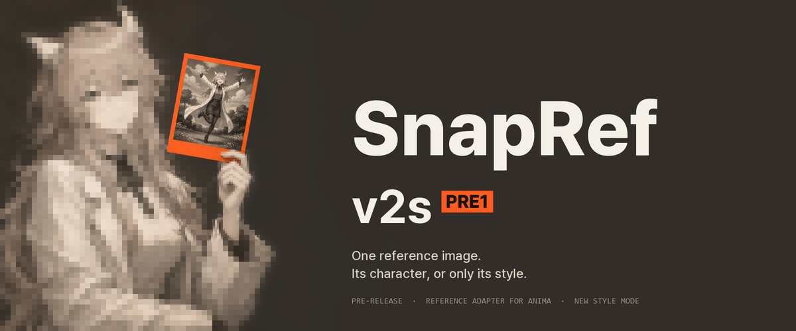
</p>

> [!NOTE]
> **SnapRef v2s PRE1 = SnapRef v2a stable + a new Style mode.** Character & Style and Character give
> **bit-identical results to v2a**, so updating changes nothing you already make. **Style** is new and is a preview.
> See [Style mode](#v2s-pre1-style-mode), [the character stays out](#the-character-stays-out) and the
> [evaluation](#evaluation).

> [!IMPORTANT]
> **Please support SnapRef!** Developing these models has taken **1,000+ H100 GPU-hours** and **800,000 training images** so far.
> If SnapRef is useful to you, a ⭐ on [GitHub](https://github.com/ArcAnima/SnapRef), sharing your results or
> reporting issues helps a lot, and GPU sponsorship is very welcome.
>
> **[Support SnapRef on Ko-fi](https://ko-fi.com/luis3207)**

<p align="center">
  <a href="https://huggingface.co/0ppxnhximxr/snapref-v2s"></a>
  <a href="https://huggingface.co/0ppxnhximxr/snapref-v2a"></a>
  <a href="https://huggingface.co/spaces/0ppxnhximxr/snapref-v2s"></a>
  <a href="https://civitai.com/models/3028191/snapref"></a>
  <a href="https://ko-fi.com/luis3207"></a>
  <a href="https://huggingface.co/circlestone-labs/Anima"></a>
  <a href="https://github.com/ArcAnima/SnapRef/tree/main/comfyui_nodes/snapref"></a>
  <a href="https://github.com/ArcAnima/SnapRef/blob/main/LICENSE"></a>
</p>

<p align="center">
  <b>Give Anima one picture. Take its character, or only its style.</b><br>
  Hair, eyes and outfit come from the reference and follow the new pose. The art style comes from the reference too,<br>
  or, with <code>mode char</code>, from the base model and your prompt.<br>
  New in v2s: <b>Style</b> takes only the art style of the picture; you write the character in the prompt.
</p>

<p align="center">
  <a href="#quick-start">Quick start</a> ·
  <a href="#v2s-pre1-style-mode">v2s Style mode</a> ·
  <a href="#v2a-stable">v2a stable</a> ·
  <a href="#evaluation">Evaluation</a> ·
  <a href="#how-it-works">How it works</a> ·
  <a href="#training-it-yourself">Training</a> ·
  <a href="#roadmap">Roadmap</a> ·
  <a href="#changelog">Changelog</a>
</p>

---

This repository contains the training, data generation and evaluation code for **SnapRef**, a reference
adapter for [Anima](https://huggingface.co/circlestone-labs/Anima) base v1.0.
**[v2s PRE1](https://huggingface.co/0ppxnhximxr/snapref-v2s)** is the newest release: v2a stable plus a new
Style mode (preview). Its Character & Style and Character modes give bit-identical results to v2a.
**[v2a stable](https://civitai.com/models/3028191/snapref?modelVersionId=3457619)** remains the stable release;
[v1a](https://huggingface.co/0ppxnhximxr/snapref-v1a),
[v1b](https://huggingface.co/0ppxnhximxr/snapref-v1b) and the earlier
[pre1](https://huggingface.co/0ppxnhximxr/snapref-v2a-pre1) /
[pre2](https://huggingface.co/0ppxnhximxr/snapref-v2a-pre2) builds remain available for comparison.
The node in `comfyui_nodes/snapref/` supports these adapter versions.

Download v2s PRE1 from [Hugging Face](https://huggingface.co/0ppxnhximxr/snapref-v2s) or try it in the
[Space](https://huggingface.co/spaces/0ppxnhximxr/snapref-v2s). SnapRef is also on
[Civitai](https://civitai.com/models/3028191/snapref), where v2a stable comes together with the
[node and workflows ZIP](https://civitai.com/api/download/models/3457619?type=Archive&format=Other).

## Highlights

|  |  |
|---|---|
| 🖌️ **Style mode** <sup>new in v2s</sup> | Any character, written in the prompt, in the art style of a picture. The picture's character stays out. |
| 🖼️ **Several style pictures** <sup>new in v2s</sup> | Several pictures by the same artist, each with its own Strength, for a steadier style. |
| ⚡ **Fast** | The reference is encoded once and its keys/values are cached. Generation is about 15 % slower than plain Anima, and faster than the other Anima reference adapters. |
| 🎯 **Scene-only prompts** | No character name, appearance or artist tags. The reference carries them. |
| 🔌 **Drop-in node** | One ComfyUI node patches the model. Works with the bf16 and the FP8 Anima base. |
| 🎨 **Character reference** | `mode char` takes the character and leaves the reference's art style behind (much stronger in v2a). |
| 👥 **Two characters** | Stitch two references side by side and prompt `2girls`. |
| 🧩 **Several references, one character** | `image_2`, `image_3`: e.g. an upper-body shot for the face and a full-body shot for the outfit. |
| ⚖️ **Reference weights** | `weight_1` … `weight_3`: how much each reference counts, without slowing generation down. |

## Quick start

1. Install Anima base v1.0 with its text encoder and VAE in ComfyUI.
2. Copy [`comfyui_nodes/snapref/`](comfyui_nodes/snapref) from this repository to `ComfyUI/custom_nodes/snapref/`
   and restart ComfyUI. This is the newest node; it works with every SnapRef version, and **Style mode needs it**.
   If SnapRef is already installed, update that copy in place (replace its files, or `git pull` if you cloned this
   repository into `custom_nodes`) and **keep only one SnapRef in `custom_nodes`**: when two copies are installed,
   the one that loads second is skipped, so an older copy can hide Style mode.
3. Put the weights in `ComfyUI/models/loras/`:

   | weights | |
   |---|---|
   | [`snapref_v2s_pre1.safetensors`](https://huggingface.co/0ppxnhximxr/snapref-v2s/resolve/main/snapref_v2s_pre1.safetensors?download=true) | newest: v2a stable + Style mode (preview), 543 MB |
   | [`snapref_v2s_pre1_fp8.safetensors`](https://huggingface.co/0ppxnhximxr/snapref-v2s/resolve/main/snapref_v2s_pre1_fp8.safetensors?download=true) | optional FP8 storage variant of v2s PRE1, about 278 MB (about 49% smaller); the node restores it to BF16 for inference. Character & Style and Character results are identical to the v2a FP8 file; Style results can differ slightly from the BF16 file |
   | [`snapref_v2a.safetensors`](https://civitai.com/models/3028191/snapref?modelVersionId=3457619) | stable; public download on Civitai |
   | [`snapref_v1a.safetensors`](https://huggingface.co/0ppxnhximxr/snapref-v1a) | previous stable release; public download |
   | [`snapref_v2a_pre2.safetensors`](https://huggingface.co/0ppxnhximxr/snapref-v2a-pre2) | earlier preview |
   | [`snapref_v2a_pre1.safetensors`](https://huggingface.co/0ppxnhximxr/snapref-v2a-pre1) | earlier preview |
   | [`snapref_v1b.safetensors`](https://huggingface.co/0ppxnhximxr/snapref-v1b) | twice the LoRA rank of v1a |

   v1a, v1b, v2a stable ([on Hugging Face](https://huggingface.co/0ppxnhximxr/snapref-v2a)) and the preview builds
   also have FP8 variants; the v2a file linked above is bf16. FP8 files store the LoRA matrices as E4M3FN with
   per-row scales; results can differ slightly from the bf16 file.
4. Open one of the [eight v2s workflows](https://huggingface.co/0ppxnhximxr/snapref-v2s/tree/main/workflows):
   `snapref_v2s_style.json` for Style mode, `snapref_v2s_simple.json` for the character modes. Choose your
   picture in the **SnapRef** node and queue. The [v2a node and workflows ZIP](https://civitai.com/api/download/models/3457619?type=Archive&format=Other)
   includes six workflows configured for `snapref_v2a.safetensors`; for Style mode, use the node from this repository.

In Character & Style and Character, write only the scene:

```text
masterpiece, best quality, score_7, safe, 1girl, solo, full body, sitting, crossed legs, bench, street, night
```

In Style mode, write the character and the scene, as you would without a reference:

```text
masterpiece, best quality, score_7, safe, 1girl, solo, short silver hair, blue eyes, maid, apron,
holding tray, cafe interior, smile, cowboy shot
```

> [!NOTE]
> SnapRef is not a regular LoRA. Load it with a SnapRef node, not with LoraLoader.

**Two nodes.**

| node | for | inputs |
|---|---|---|
| **SnapRef** | everyone | up to eight pictures picked inside the node (click or drop), Mode (*Character & Style* / *Character* / *Style*), Strength per picture, Fidelity |
| **SnapRef (Advanced)** | full control | every setting (below and in the [v1a model card](https://huggingface.co/0ppxnhximxr/snapref-v1a#settings)); saved workflows open on it unchanged |

**Three modes.**

| SnapRef | SnapRef (Advanced) | from the pictures | in the prompt |
|---|---|---|---|
| Character & Style | `cs` | the character and its art style | only the scene |
| Character | `char` | only the character | the scene; add artist or style tags for the style |
| **Style** <sup>v2s</sup> | `style` | only the art style; the character stays out | the character and the scene |

Style needs an adapter with a style branch, such as `snapref_v2s_pre1.safetensors`. With v2a or older files the Style
button is dimmed; a workflow saved in Style mode keeps that setting and shows a warning until you select a v2s
file. One node uses one mode: a character reference and a style reference in the same generation are not supported.

After filling two pictures, click the square **+** button to the right of **Character** to add another
reference slot (up to eight pictures of the same character, or in Style mode by the same artist). Each picture
has its own Strength; Fidelity applies to all references. Existing one- and two-picture workflows remain compatible.

On the simple node, **Strength** is how much a picture counts (1 = as trained, 0 = off, 2 = twice) and
**Fidelity** trades detail for prompt freedom (1 = every detail of the picture; lower also lets the negative
prompt branch read the picture, so the prompt is followed more freely, about 12 % slower). In Style mode,
Strength above `1.0` starts to bring in the pictures' character.

**Fidelity** is also available on the advanced node (0–1, default 1). It is ignored when
`ref_in_uncond` or `ref_guidance_on` is on. It is appended after the existing inputs to preserve saved workflows.

Inputs of SnapRef (Advanced) added for v2a:

| new node input | default | |
|---|---|---|
| `image_2`, `image_3` | | more references of the **same** character (e.g. full body when `image` is an upper-body shot) |
| `use_batch` | off | use every image of an IMAGE batch as a reference |
| `multi_layout` | `separate` | `separate`: each reference on its own. `stitch`: side by side in one reference (same speed as one image) |
| `weight_1` … `weight_3` | 1.0 | how much each reference counts (0–2, 0 = skipped); separate layout only |

The new inputs sit at the end of the node, so saved v1 workflows open unchanged.

For v2s, `mode` gains `style`. In `style`, keep `strength` at `0.0` and `ref_caption` empty; `image_2` and
`image_3` can be more pictures by the same artist.

## Anima-2.9B block routing

Both SnapRef nodes automatically recognize a 28-block adapter on Anima-2.9B's known
40-block depth expansion. Adapter hooks follow the original layers at
`0, 1, 3, 4, 6, 7, 9, 10, 12, 13, 15, 16, 18, 19, 20, 22, 23, 25, 26, 28, 29, 31, 32, 34, 35, 37, 38, 39`.
The inserted layers keep their own weights, and reference K/V caches retain all 40
actual layer positions. Native layouts keep their original routing. Other block-count
mismatches raise an error before generation rather than silently using the wrong layers.
No extra node or setting is needed.

This corrects weight routing; it does not establish reference quality on 2.9B or its
finetunes, since the adapters were trained on Anima base v1.0. CPU hook, reference-cache,
and model-reload regressions can be run with `python -m unittest discover -s tests -v`
(PyTorch and safetensors required, no ComfyUI or checkpoints).

## v2s PRE1: Style mode

**Style** takes only the art style of the pictures: line weight, color palette, lighting and shading. The character
comes from your prompt. The figures use **CFG 4.5 · Euler / simple · 28 steps · Fidelity 1.0** on Anima base v1.0.

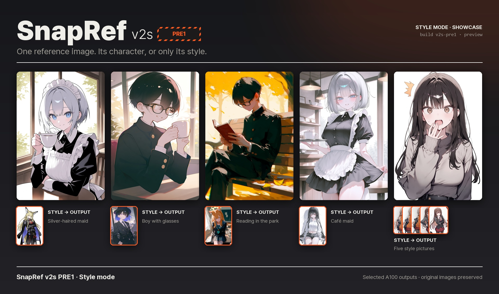

<sub>Each output is a different character written in the prompt (a maid, a boy with glasses, a reader in the park)
drawn in the art style of the picture under it. The last one uses five pictures by the same artist.</sub>

### One prompt, different style pictures

Keep the prompt and the seed, change only the style picture.

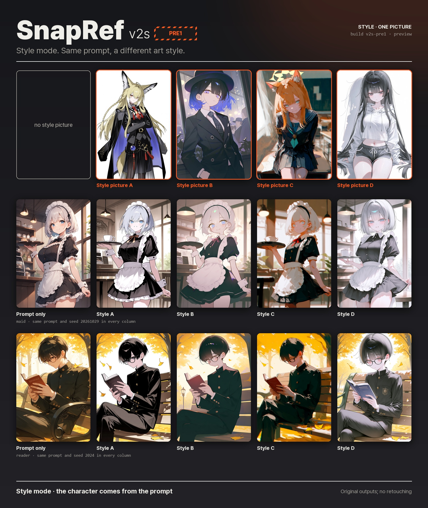

<sub>Same prompt and seed in every column of a row. The left column uses no style picture. Some pictures change
the palette and lighting more than the construction of the face; see <a href="#known-limitations">Known limitations</a>.</sub>

### The character stays out

The same picture behaves differently in the two modes. **Character & Style** draws the character in the picture.
**Style** draws the character in your prompt, in the picture's style; the fox ears, the hat and the outfits of the
pictures do not carry over.

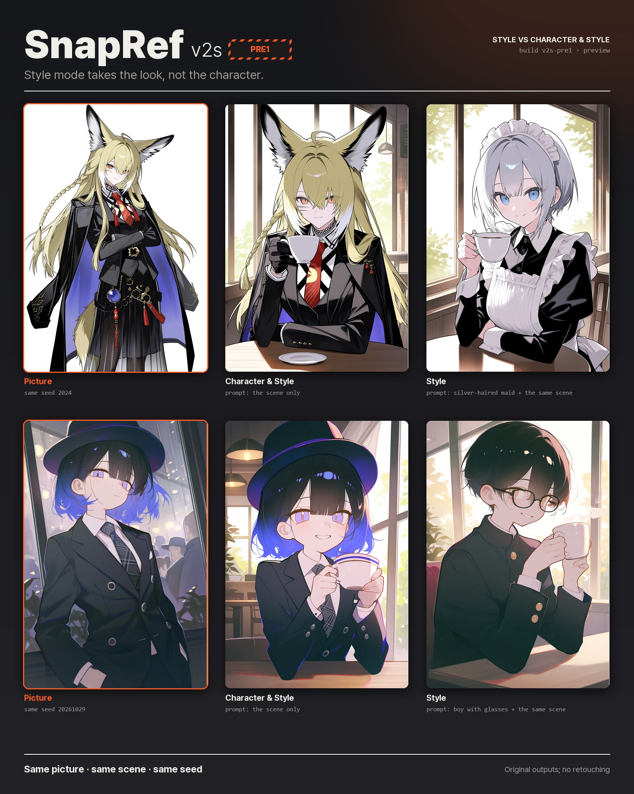

<sub>Same picture, same scene and same seed in each row. The Character & Style prompt describes only the scene;
the Style prompt adds the character (a silver-haired maid, a boy with glasses).</sub>

### Several style pictures

Give several pictures by the same artist. What the pictures share is the art style, so several of them can
reinforce it. Below, five pictures of **two different characters** by one artist, each with its own Strength.

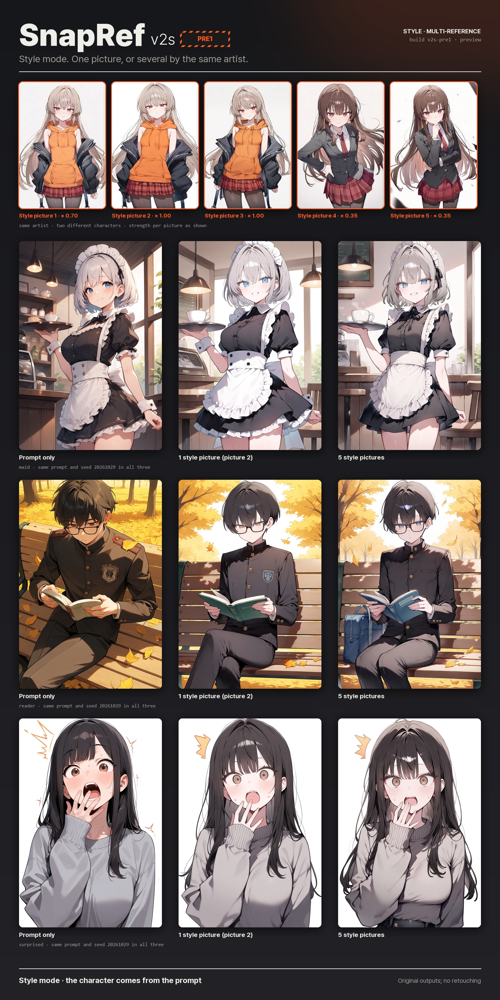

<sub>Same prompt and seed in each row. One picture already changes the rendering; five pictures can make it steadier
and closer to the set, more visibly in some scenes (bottom row) than in others. Several style pictures were not
part of training and are not in the evaluation below.</sub>

> [!TIP]
> **Style mode in three steps.** Choose **Style**, put one or more pictures in the art style you want into the
> picture slots, and write the character and the scene in the prompt. Keep Strength at `1.0` to start; lower a
> picture's Strength (for example `0.35`) when it pulls too much of its own look into the result.

## v2a stable

Character, style and multi-reference examples generated with the stable adapter on Anima base v1.0.
Character & Style and Character in v2s PRE1 are bit-identical to v2a stable, so these examples are also what
v2s draws in those modes.

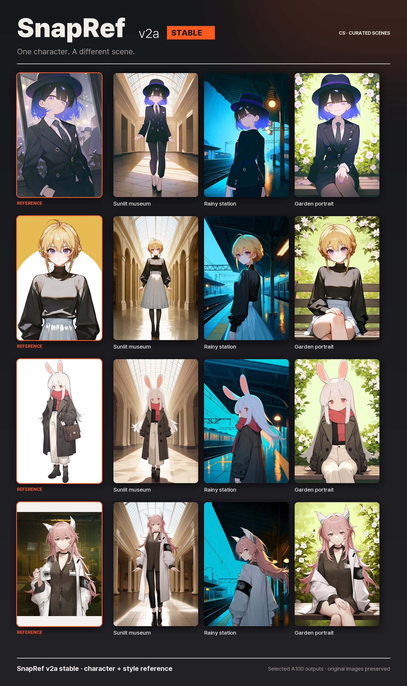

<sub>Four references, three scene prompts. Orange outlines mark the inputs. The prompts describe the scene,
pose and lighting without character names or appearance tags.</sub>

### Character styles

Keep the reference, change the style prompt. These examples use `char` mode with watercolor, 1990s anime
and flat-color treatments; the scene and seed stay the same within each row.

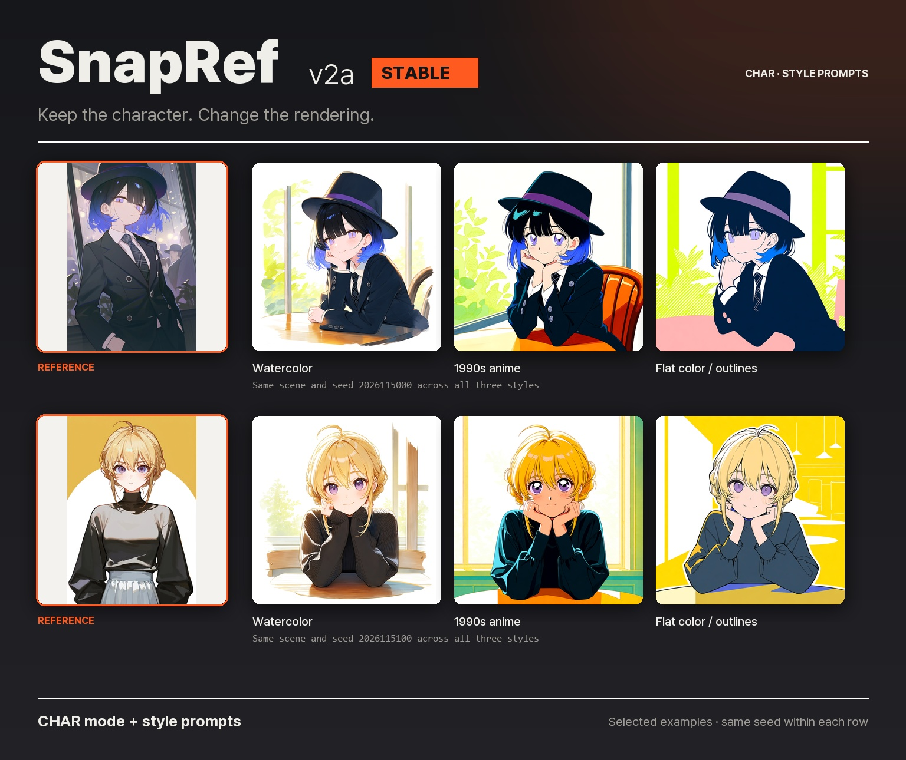

<sub>The reference supplies the character, while the style prompt changes the rendering. Fine details
such as eyewear and collars can still vary.</sub>

### Multi-reference

Use **two pictures of the same character**: one with a clear face and another showing the full outfit.
In `separate` layout, the references are encoded individually and used together during generation.

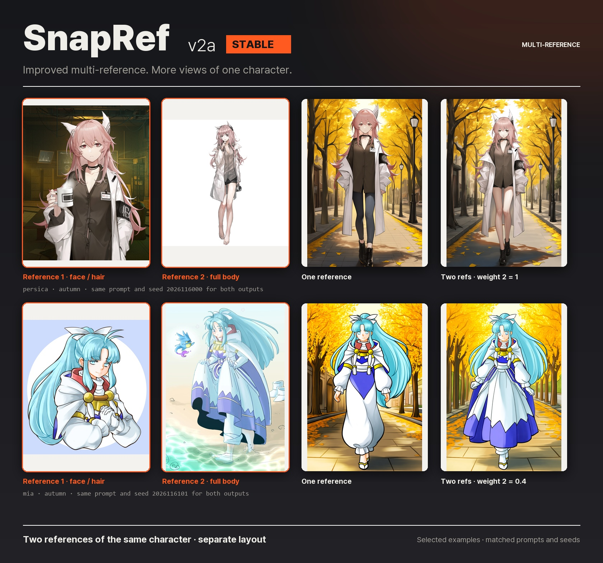

<sub>One reference versus two, with the same prompt and seed in each row. The second-reference weight is
**1.0 for Persica** and **0.4 for Mia**. These are selected examples, not an aggregate improvement score.</sub>

### The same pair, another scene

The same two pictures can guide a walking pose outdoors or a seated portrait in a study.
Keep `solo` in the prompt when you want one character.

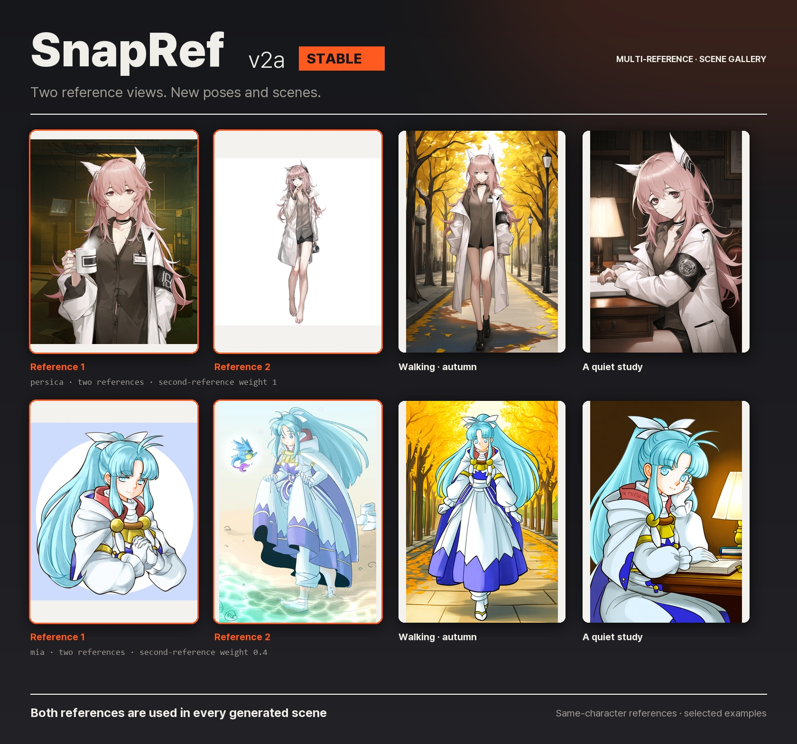

<sub>Both references contribute to every output. These scenes use independently selected seeds;
the controlled one-versus-two comparison is the figure above.</sub>

### Reference weights

Start with both weights at `1.0`. If a second picture changes the look too much, try lowering its weight.
`0.4` gives it a smaller contribution; `0` skips it. Per-reference weights apply in `separate` layout.

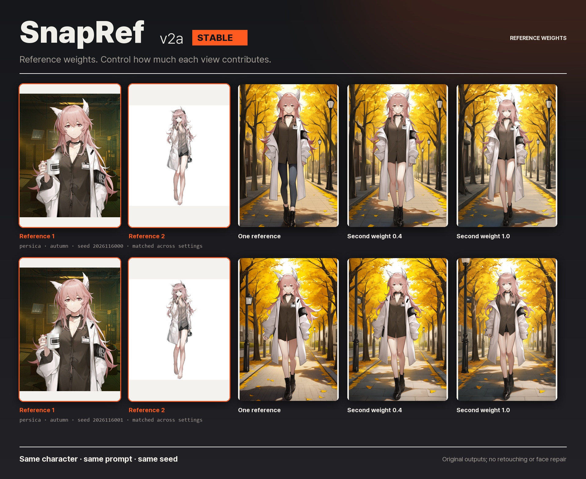

<sub>Each row keeps the prompt and seed fixed. The first-reference weight remains 1.0.
Higher weight is not a guarantee of a better result.</sub>

### More scenes

### Persica, from a single reference

A museum atrium, a railway platform and a garden bench: different framing and lighting from one input.

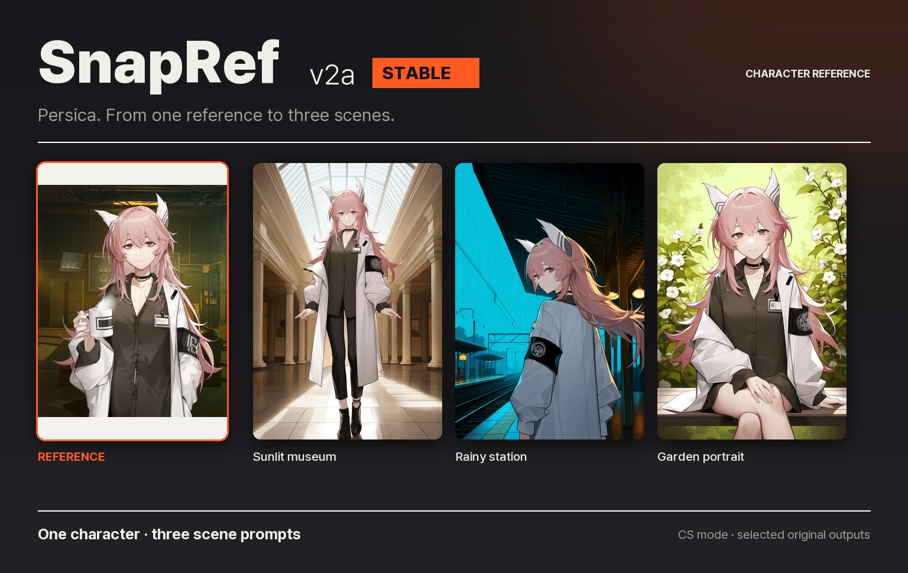

### After the rain

Three independent characters under the same scene prompt. Cool platform lighting and warm reflections
give the reference designs a different atmosphere.

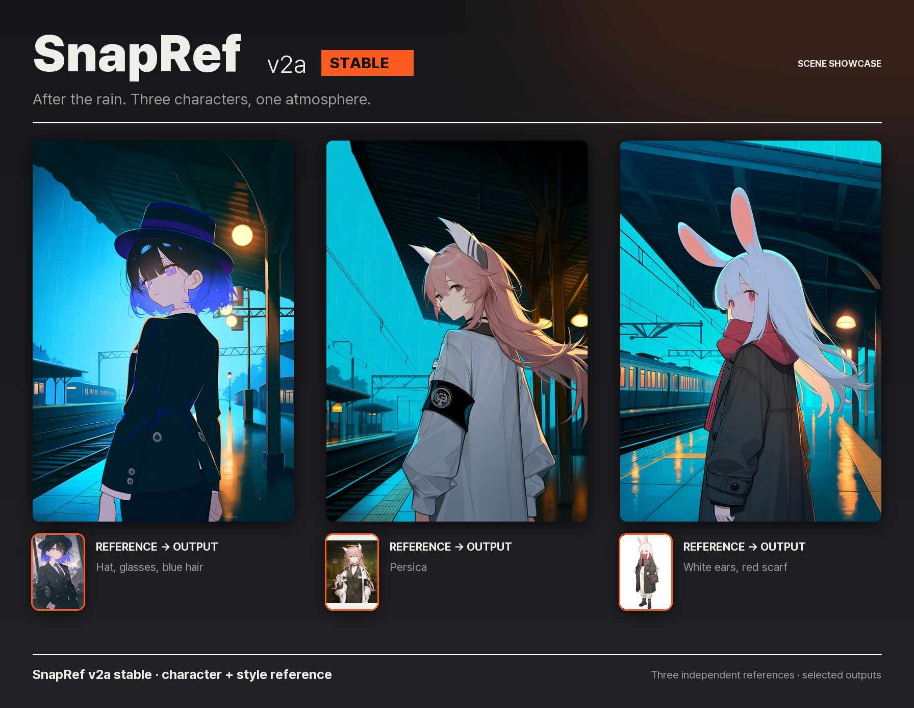

<sub>Selected examples generated with SnapRef v2a.
The examples are curated separately from the fixed evaluation.</sub>

## Evaluation

### Style mode (v2s PRE1)

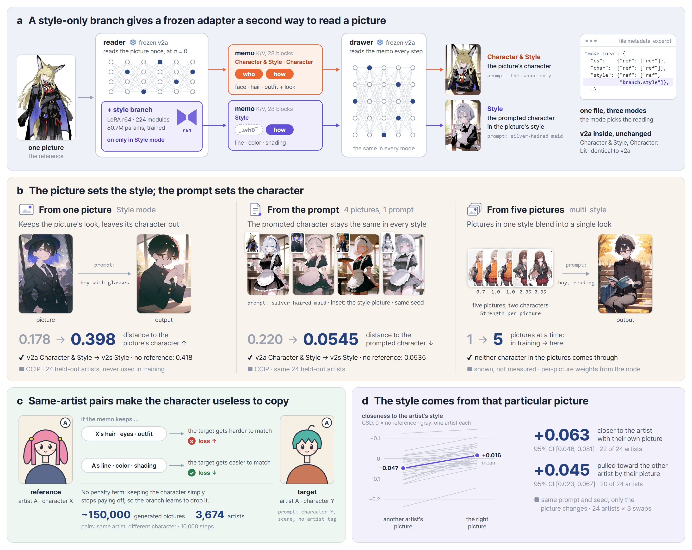

<sub>**a** The two readings of one picture: the reader and drawer are the frozen v2a parts, and only Style mode adds
the branch. **b** What Style mode keeps and leaves out; the numbers are the held-out evaluation below. **c** Why the
branch drops the character. **d** Swap test; each gray line is one held-out artist.</sub>

24 held-out artists that were never used in training, one style picture each.

| Metric | No reference | v2a Character & Style | **v2s Style** |
|---|---:|---:|---:|
| Distance to the picture's character (CCIP) ↑, higher = less copied | 0.418 | 0.178 | **0.398** |
| Distance to the prompted character (CCIP) ↓ | 0.0535 | 0.220 | **0.0545** |

| Swap test (same prompt and seed, the style picture replaced by another artist's) | Result |
|---|---|
| Closer to the right artist's style with the right picture (CSD) | **+0.063** [0.046, 0.081], 92% of cases |
| With another artist's picture, the output moves toward that artist (CSD) | **+0.045** [0.023, 0.067], 83% of cases |

Style mode copies the picture's character about as little as using no reference at all, keeps the prompted
character as well as no reference does, and follows **that** artist's style: swapping the picture moves the output
toward the new artist. Brackets are 95% bootstrap intervals. The metrics are sensitive to framing, pose and
lighting; the figures above are selected examples.

### Character modes (v1a and v2a)

Character & Style and Character in v2s PRE1 are bit-identical to v2a on our fixed parity set and on the v2a
release workflows; the v2a weights inside the v2s file are byte-identical. The v2a numbers below apply unchanged.

The fixed evaluation contains **64 cases × 2 seeds**, separate from the curated figures above.

| Metric | v1a | **v2a** |
|---|---:|---:|
| Appearance tag recall ↑ | 0.8722 | **0.8727** |
| Extra appearance tags ↓ | 0.1341 | **0.1401** |
| Head SigLIP similarity ↑ | 0.8989 | **0.8903** |
| Head DINO similarity ↑ | 0.7431 | **0.7407** |
| Head CCIP distance ↓ | 0.0684 | **0.0715** |
| Full-image CCIP distance ↓ | 0.0725 | **0.0757** |

Appearance-tag recall improves slightly, while our qualitative assessment shows substantially better
reference following than v1a. A remaining issue is that the model can struggle to reproduce facial
details when the face in the reference image is very bright.

## How it works

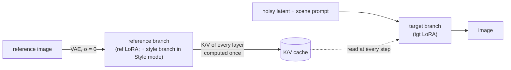

- **Asymmetric attention.** The target tokens attend to themselves and to the cached reference. The reference
  never attends to the target, so it can be computed once, before sampling starts.
- **Two LoRAs.** The reference branch and the target branch each have their own LoRA (v1a: rank 128 and 64).
- **Separate position.** The reference sits at its own place in the model's RoPE coordinates, so it is read for
  appearance and not copied as a layout.
- **Several references.** Each reference is encoded on its own and the cached K/V of all of them are
  concatenated; a reference weight adds `log(w)` to that reference's keys.
- **Style branch (v2s).** v2s keeps the v2a weights frozen and adds a small style-only branch to the reference
  branch, active only in Style mode, so the reference is summarized as "how it is drawn" rather than "who it is".
  The target branch is unchanged. In Character & Style and Character the branch is off and the computation is v2a's.
- **Training data.** v1a: 58,300 images generated with Anima itself (`scenes3x4`): 2,367 characters, each drawn in
  several scenes and poses in one artist style. The training prompt leaves out what the reference supplies.
  The earlier v2a-pre1 / pre2 run continued from v1a with 231,724 Danbooru illustrations as 80 % of the pairs.
  v2a stable uses a fresh adapter trained on the expanded synthetic corpus. The v2s style branch was trained on
  pairs drawn from about 150,000 generated pictures by 3,674 artists: a picture by one artist as the reference and
  another picture by the same artist, of a **different character**, as the target, with that character written in
  the prompt and no artist tag. Copying the reference's character makes such a pair harder to match, while its
  line work and coloring help, so the branch learned to keep the style and leave the character out.

## Training it yourself

```bash
# 1. data: scenes x poses per character, rendered with ComfyUI (one worker per GPU)
PROJECT_ROOT=$PWD bash deploy/run_scenes3x4.sh production
# 2. text contexts + latents -> safetensors, then train, preview and compare every checkpoint
GPUS=0,1 FIRST=v1a bash deploy/train_pipeline.sh   # configs/train_asym_<name>.json
# 3. score a comparison run
python train/score_panels.py RUN_A RUN_B --label a b --out scores.json
# Historical v2a-pre1 / pre2 mixed-data training example (configs/train_v2a.json)
python train/train_asym.py --prep v2_mix_prep --config configs/train_v2a.json --init snapref_v1a.safetensors --out runs/v2a
```

| path | |
|---|---|
| `train/asym.py` | asymmetric attention, reference K/V cache, the two LoRAs |
| `train/prepare_asym.py`, `train/train_asym.py` | tensor preparation and training |
| `train/eval_asym.py`, `train/compare_refs.py`, `train/score_panels.py` | held-out loss gaps, side-by-side runs against other adapters, embedding scores |
| `train/anima_env.py`, `train/sample.py`, `train/preview.py`, `train/prepare*.py` | model plumbing on top of ComfyUI, sampling, in-training previews, shared data helpers |
| `comfyui_nodes/snapref/` | the ComfyUI nodes: SnapRef (simple, `simple.py` + `web/snapref.js`) and SnapRef (Advanced); `adapter_info.py` tells the simple node which adapters have Style mode |
| `train/detail_eval/` | detail evaluation: frozen set, renders, tag / head-crop features, paired CIs, watcher |
| `train/multiref_test.py`, `train/ccip_eval.py` | multi-reference test, CCIP identity scores |
| `datagen/select_v2_images.py`, `datagen/build_pairs_v2.py`, `train/D_build_v2_prep.py`, `train/D_merge_preps.py` | v2a-pre1 / pre2 data: Danbooru selection (tags only), training pairs, prep, merge with the generated prep |
| `datagen/clean_tags_v2.py`, `configs/datagen_scenes_v2.json` | the scenes_v2 synthetic data run (v2a-syn) |
| `train/style_research/`, `train/style_*.py` | the v2 style-transfer experiments (did not beat the baseline) |
| `datagen/` | tag catalogs, scene manifests, pose extension, ComfyUI batch workflow and GPU worker |
| `configs/` | the configs of the released runs: `datagen_scenes.json`, `train_asym.json` (v1a), `train_asym_v1b.json`, `train_v2a.json` (v2a-pre1 / pre2), `datagen_scenes_v2.json` |
| `comfyui_nodes/anima_ref_datagen_nodes/` | batched generation nodes used to render the training data |
| `deploy/` | GPU box setup, data generation launcher, training pipeline, FP8 conversion |

Data generation and training of v1a alone took about 120 H100 GPU-hours.

## Roadmap

- [x] **v1a**: asymmetric attention + K/V cache, 58k generated images. Released.
- [x] **v1b**: twice the LoRA rank. Keeps the character as well as v1a and follows the prompt slightly more closely.
  Released as [snapref-v1b](https://huggingface.co/0ppxnhximxr/snapref-v1b).
- [x] **v2a-pre1 / pre2**: continued from v1a with 80 % real Danbooru illustrations. Much stronger `mode char`;
  multi-reference and reference weights in the node. Earlier preview builds on Hugging Face.
- [x] **v2a stable**: fresh adapter on expanded synthetic data; stable weights selected and figures evaluated.
  The character-mode evaluation above compares v1a and v2a.
- [x] **v2s PRE1**: Style mode (preview) on top of v2a stable, with several style pictures and a Strength for each.
  Released as [snapref-v2s](https://huggingface.co/0ppxnhximxr/snapref-v2s).
- [ ] Multi-reference training (2–3 references → another pose).

## Compatibility and troubleshooting

- **Style button dimmed or missing.** Dimmed: the selected adapter has no Style mode (v2a and older files);
  select `snapref_v2s_pre1.safetensors` or its FP8 file. Missing: an older SnapRef node is loaded. Update it in place and keep only
  one SnapRef in `custom_nodes`; the copy that loads second is skipped with a warning in the ComfyUI log.
- **Black image with an fp16 model or `--fast`.** Fixed in the node update of 2026-10-31. Anima overflows in
  fp16. ComfyUI runs the model in fp16 when the checkpoint is stored in fp16 (many merges), with `--fp16-unet`,
  or with `--fast` / `--fast fp16_accumulation`. The old node encoded the reference in fp16 there and produced NaN.
  The new node keeps that part in fp32, as ComfyUI itself does. bf16 output is unchanged (same bits). With the
  old node, add `--bf16-unet` to the ComfyUI launch arguments, or drop `fp16_accumulation` from `--fast`.
- **Anzhc Mod Guidance:** works in either node order with the updated node. Before, applying Mod Guidance first
  dropped the reference.
- **Spectrum:** works with `ref_guidance_on` off. With it on, Spectrum-type step forecasting breaks; the node now
  logs a warning.
- **sorryhyun Spectrum/Mod Guidance:** the default positive-only reference setting works with the updated node.
  Reference encoding excludes target modulation, and Mod Guidance's full CFG batch is kept intact while only
  positive rows read the reference. This fixes the reported 4-vs-2 error without enabling `ref_in_uncond` or
  `ref_guidance_on`. Actual image batches larger than one also need Spectrum's own projection-row expansion fix
  (tested against 2.13.4); SnapRef alone cannot repair Spectrum's cached-forward batch handling.
- **SageAttention:** with `strength` or reference weights ≠ 1, the reference part uses PyTorch's fused attention,
  so a GPU where Sage is much faster can be slightly slower there.
- **Reference cache:** the reference is encoded once and kept between runs while the picture and settings stay the
  same (about 0.9 GB of VRAM for a 1 MP picture); "Free model and node cache" in ComfyUI releases it.

## Known limitations

Style mode (v2s PRE1):

- **Style is a preview.** Some pictures change the palette, lighting and line quality more than the way faces are drawn.
- A little of a picture's coloring can carry over, such as a dark outfit or a skin tone. Name colors in the prompt
  when they matter.
- Strength above `1.0` (or Advanced `strength` above `0`) brings in more of the pictures' character and follows the
  prompt less.
- One node uses one mode. Combining a character reference and a style reference in the same generation is not
  supported yet.
- Use pictures you have the right to use, and respect the artists whose work you reference. Artwork text or
  signature-like marks can be copied from a reference; inspect outputs before sharing them.

Character modes (v2a, unchanged in v2s):

- Very small details (earrings, fine patterns, scars) can be simplified.
- A dark-skinned reference can come out with lighter skin.
- A scene can override the reference outfit (*beach* → swimsuit). Raise `strength` or name the outfit.
- v2a does not improve every identity metric over v1a; see the fixed evaluation above.
- v2a `mode char`: a few outfit details of the reference can change (a patterned item drawn plain, a hat left out).

## Changelog

### v2s PRE1

- **New Style mode.** Takes only the art style of the pictures; the character comes from the prompt. Several
  style pictures can be combined, each with its own Strength.
- **Character & Style and Character are unchanged:** bit-identical to v2a stable. The v2a weights are inside the
  file byte for byte, and the Style parts switch on only in Style mode.
- **ComfyUI node:** Style in SnapRef and SnapRef (Advanced). The picture panel shows each mode in its own color
  with matching card labels and a one-line prompt hint, and dims the Style button for adapters without Style mode.
  v2a and older adapter files keep working.
- **Two new workflows:** Style and Style (Advanced), among the
  [eight v2s workflows](https://huggingface.co/0ppxnhximxr/snapref-v2s/tree/main/workflows).
- **Weight file:** `snapref_v2s_pre1.safetensors`, 543,395,968 bytes (about 543 MB, about 162 MB more than v2a for
  the Style branch), SHA-256 `95f91797827cbf5efd86e29fac5b2646df1505d46acb20f913877b3c9a429609`.
  Optional FP8 file: `snapref_v2s_pre1_fp8.safetensors`, 278,127,904 bytes (about 278 MB),
  SHA-256 `55a429f078d74f3e144a89d14aaaaedbd9f51c2ac598728f8f0135a6e67a1600`.
- **FP8 converter:** `deploy/quantize_adapter_fp8.py` also converts the Style branch, so v2s files can be stored as FP8.

### v2a stable

Character reference, several views of one character and per-reference weights. See the
[v2a model card](https://huggingface.co/0ppxnhximxr/snapref-v2a).

## License

- **Code:** Apache-2.0 ([LICENSE](LICENSE)).
- **Weights:** a derivative of the CircleStone Model, under the CircleStone Labs Non-Commercial License v1.2
  (see the model cards, e.g. [v1a](https://huggingface.co/0ppxnhximxr/snapref-v1a)). Images generated with Anima are
  subject to that license as well. Not affiliated with or endorsed by CircleStone Labs.
