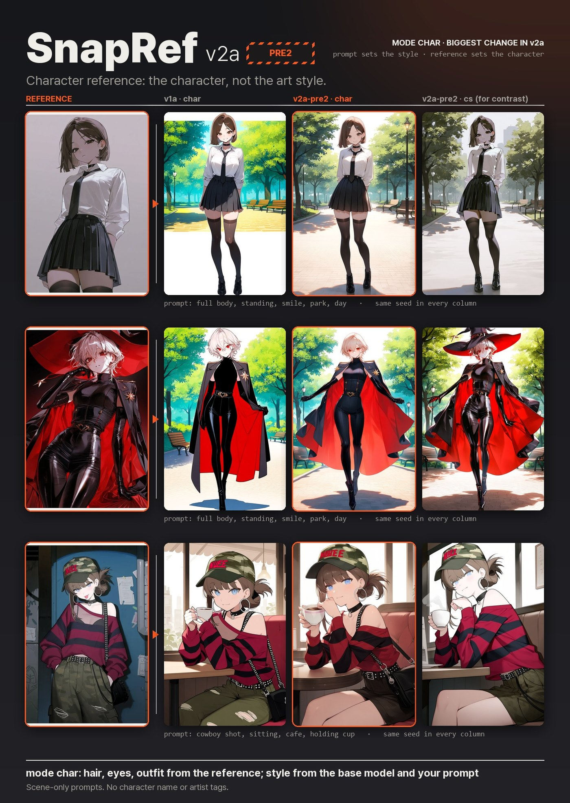
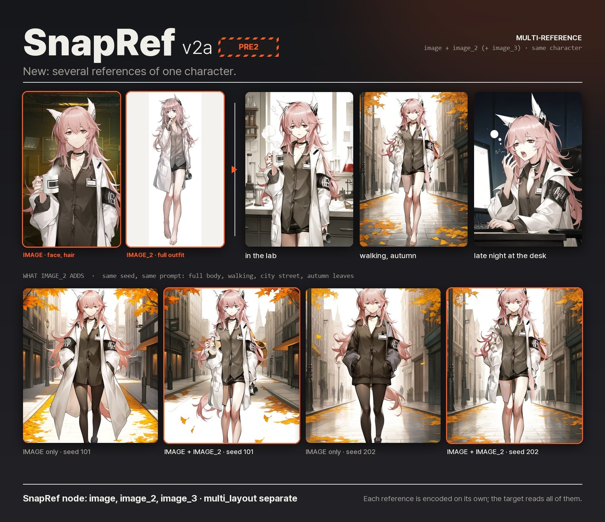
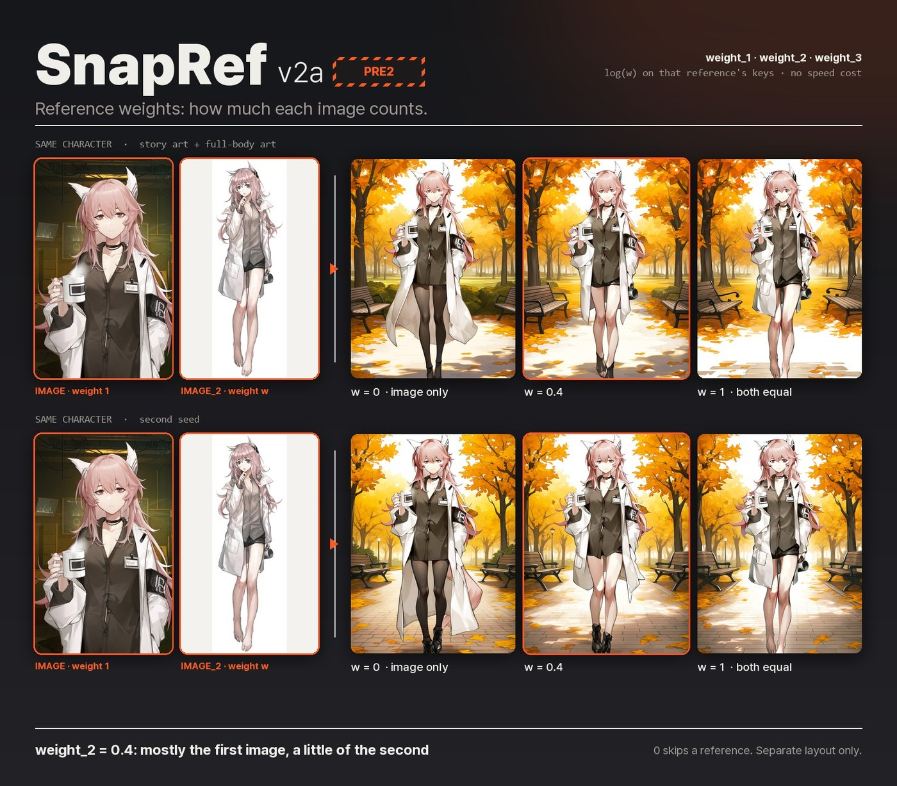
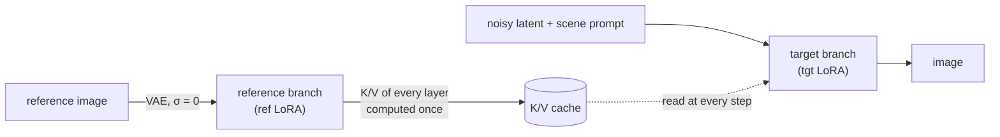

<p align="center">
  
</p>

> [!NOTE]
> **New: [v2a-pre1](https://huggingface.co/0ppxnhximxr/snapref-v2a-pre1) and [v2a-pre2](https://huggingface.co/0ppxnhximxr/snapref-v2a-pre2)
> preview builds** with a much stronger character mode, several references of one character, and per-reference
> weights. [What is new in v2a](#v2a-preview). v1a stays the recommended release.

> [!IMPORTANT]
> **Please support SnapRef!** Developing these models has taken **400+ H100 GPU-hours** so far.
> If SnapRef is useful to you, a ⭐ on [GitHub](https://github.com/ArcAnima/SnapRef), sharing your results or
> reporting issues helps a lot, and GPU sponsorship is very welcome.

<p align="center">
  <a href="https://huggingface.co/0ppxnhximxr/snapref-v1a"></a>
  <a href="https://huggingface.co/0ppxnhximxr/snapref-v1b"></a>
  <a href="https://huggingface.co/0ppxnhximxr/snapref-v2a-pre2"></a>
  
  
  
  
</p>

<p align="center">
  <b>Give Anima one picture of a character. Write only the scene.</b><br>
  Hair, eyes and outfit come from the reference and follow the new pose. The art style comes from the reference too,<br>
  or, with <code>mode char</code>, from the base model and your prompt.
</p>

<p align="center">
  <a href="#quick-start">Quick start</a> ·
  <a href="#v2a-preview">v2a preview</a> ·
  <a href="#results-v1a">Results</a> ·
  <a href="#how-it-works">How it works</a> ·
  <a href="#training-it-yourself">Training</a> ·
  <a href="#roadmap">Roadmap</a>
</p>

---

This repository holds the training, data generation and evaluation code behind **SnapRef**, a reference adapter
for [Anima](https://huggingface.co/circlestone-labs/Anima) base v1.0. The released weights, ComfyUI node and
workflows are on Hugging Face: **[snapref-v1a](https://huggingface.co/0ppxnhximxr/snapref-v1a)** (recommended),
**[snapref-v1b](https://huggingface.co/0ppxnhximxr/snapref-v1b)** (twice the LoRA rank), and the preview builds
**[snapref-v2a-pre1](https://huggingface.co/0ppxnhximxr/snapref-v2a-pre1)** and
**[snapref-v2a-pre2](https://huggingface.co/0ppxnhximxr/snapref-v2a-pre2)**. The node in `comfyui_nodes/snapref/`
works with all of them.

## Highlights

|  |  |
|---|---|
| ⚡ **Fast** | The reference is encoded once and its keys/values are cached. Generation is about 15 % slower than plain Anima, and faster than the other Anima reference adapters. |
| 🎯 **Scene-only prompts** | No character name, appearance or artist tags. The reference carries them. |
| 🔌 **Drop-in node** | One ComfyUI node patches the model. Works with the bf16 and the FP8 Anima base. |
| 🎨 **Character reference** | `mode char` takes the character and leaves the reference's art style behind (much stronger in v2a). |
| 👥 **Two characters** | Stitch two references side by side and prompt `2girls`. |
| 🧩 **Several references, one character** | `image_2`, `image_3`: e.g. an upper-body shot for the face and a full-body shot for the outfit. |
| ⚖️ **Reference weights** | `weight_1` … `weight_3`: how much each reference counts, without slowing generation down. |

## Quick start

1. Install Anima base v1.0 with its text encoder and VAE in ComfyUI.
2. Copy [`comfyui_nodes/snapref/`](comfyui_nodes/snapref) from this repository to `ComfyUI/custom_nodes/snapref/`
   (replace an older SnapRef node). This is the newest node; it works with every SnapRef version.
3. Put the weights in `ComfyUI/models/loras/`:

   | weights | |
   |---|---|
   | [`snapref_v1a.safetensors`](https://huggingface.co/0ppxnhximxr/snapref-v1a) | recommended |
   | [`snapref_v2a_pre2.safetensors`](https://huggingface.co/0ppxnhximxr/snapref-v2a-pre2) | preview: stronger `mode char`; try this one first of the two previews |
   | [`snapref_v2a_pre1.safetensors`](https://huggingface.co/0ppxnhximxr/snapref-v2a-pre1) | preview: earlier checkpoint |
   | [`snapref_v1b.safetensors`](https://huggingface.co/0ppxnhximxr/snapref-v1b) | twice the LoRA rank of v1a |

   Each also comes as an FP8 file (half the size).
4. Open a workflow from the same Hugging Face page (`workflows/`), load a reference image and queue.

```text
masterpiece, best quality, score_7, safe, 1girl, solo, full body, sitting, crossed legs, bench, street, night
```

> [!NOTE]
> SnapRef is not a regular LoRA. Load it with the **SnapRef** node, not with LoraLoader.
> The basic settings are explained in the [v1a model card](https://huggingface.co/0ppxnhximxr/snapref-v1a#settings);
> the inputs added for v2a are below.

| new node input | default | |
|---|---|---|
| `image_2`, `image_3` | | more references of the **same** character (e.g. full body when `image` is an upper-body shot) |
| `use_batch` | off | use every image of an IMAGE batch as a reference |
| `multi_layout` | `separate` | `separate`: each reference on its own. `stitch`: side by side in one reference (same speed as one image) |
| `weight_1` … `weight_3` | 1.0 | how much each reference counts (0–2, 0 = skipped); separate layout only |

The new inputs sit at the end of the node, so saved v1 workflows open unchanged.

## v2a preview

Two checkpoints of the v2a run, released as previews: **v2a-pre1** (step 10,000) and **v2a-pre2** (step 15,000).
Both continue from v1a on a mix of real Danbooru illustrations (80 %) and Anima-generated images (20 %).
Try **pre2** first; pre1 is kept for comparison. Neither replaces v1a.

**Character reference (`mode char`).** The largest change. v2a takes the character from the reference and leaves
its art style behind; the base model and your prompt set the look.

<p align="center"></p>

**Several references of one character.** Each reference is encoded on its own and the image reads all of them.

<p align="center"></p>

**Reference weights.** `log(w)` on that reference's attention keys, computed without an attention mask (fused
attention per key group, merged by log-sum-exp), so `strength` and weights no longer slow generation down.

<p align="center"></p>

**How v2a compares to v1a** (detail evaluation, 64 cases × 2 seeds, difference to v1a, 95 % CI):

| | v2a-pre1 | v2a-pre2 |
|---|---:|---:|
| appearance tags kept ↑ | −0.014 [−0.047, +0.019] | −0.015 [−0.051, +0.021] |
| head-crop SigLIP2 ↑ | −0.018 [−0.025, −0.011] | −0.005 [−0.010, −0.001] |
| head-crop CCIP distance ↓ | +0.010 [+0.003, +0.017] | +0.005 [+0.001, +0.009] |
| head-crop CCIP distance, real-art references ↓ | +0.019 [+0.009, +0.032] | +0.010 [+0.004, +0.015] |

In `cs` mode neither build is better than v1a yet; pre2 is close. Real illustrations as training targets did not
help, so the next run (v2a-syn) uses Anima-generated images only: 121,642 images of 5,886 characters
(`configs/datagen_scenes_v2.json`, `datagen/clean_tags_v2.py`). The evaluation is in `train/detail_eval/`.

## Results (v1a)

<p align="center"></p>
<p align="center"><sub>Characters that were not in the training data. Every method gets the same prompt and seed; the prompt describes only the scene.</sub></p>

<details>
<summary><b>More held-out characters</b></summary>
<p align="center"></p>
</details>

Measured on 32 held-out characters (52 cases in total, same seeds), see
[`train/score_panels.py`](train/score_panels.py):

| | **SnapRef v1a** | ElectronGirl v2 | Anima, no reference |
|---|---:|---:|---:|
| DINOv2 similarity to the true image of the character ↑ | **0.722** | 0.675 | 0.493 |
| CLIP similarity to the true image ↑ | **0.863** | 0.844 | 0.670 |
| seconds per image, A100, 832×1216, 28 steps ↓ | **8.9** | 14.4 | 7.7 |
| held-out loss identity gap ↑ | **0.0040** | – | – |

<sub>The "true image" is another picture of the same held-out character in the prompted pose. Role-Ref-KV was
timed at 12.5 s on the same setup.</sub>

## How it works



- **Asymmetric attention.** The target tokens attend to themselves and to the cached reference. The reference
  never attends to the target, so it can be computed once, before sampling starts.
- **Two LoRAs.** The reference branch and the target branch each have their own LoRA (v1a: rank 128 and 64).
- **Separate position.** The reference sits at its own place in the model's RoPE coordinates, so it is read for
  appearance and not copied as a layout.
- **Several references.** Each reference is encoded on its own and the cached K/V of all of them are
  concatenated; a reference weight adds `log(w)` to that reference's keys.
- **Training data.** v1a: 58,300 images generated with Anima itself (`scenes3x4`): 2,367 characters, each drawn in
  several scenes and poses in one artist style. The training prompt leaves out what the reference supplies.
  v2a: continued from v1a with 231,724 Danbooru illustrations (33,666 characters) as 80 % of the pairs.

## Training it yourself

```bash
# 1. data: scenes x poses per character, rendered with ComfyUI (one worker per GPU)
PROJECT_ROOT=$PWD bash deploy/run_scenes3x4.sh production
# 2. text contexts + latents -> safetensors, then train, preview and compare every checkpoint
GPUS=0,1 FIRST=v1a bash deploy/train_pipeline.sh   # configs/train_asym_<name>.json
# 3. score a comparison run
python train/score_panels.py RUN_A RUN_B --label a b --out scores.json
# v2a: continue from v1a on the merged real + generated prep (configs/train_v2a.json)
python train/train_asym.py --prep v2_mix_prep --config configs/train_v2a.json --init snapref_v1a.safetensors --out runs/v2a
```

| path | |
|---|---|
| `train/asym.py` | asymmetric attention, reference K/V cache, the two LoRAs |
| `train/prepare_asym.py`, `train/train_asym.py` | tensor preparation and training |
| `train/eval_asym.py`, `train/compare_refs.py`, `train/score_panels.py` | held-out loss gaps, side-by-side runs against other adapters, embedding scores |
| `train/anima_env.py`, `train/sample.py`, `train/preview.py`, `train/prepare*.py` | model plumbing on top of ComfyUI, sampling, in-training previews, shared data helpers |
| `comfyui_nodes/snapref/` | the ComfyUI node (bf16 and FP8; multi-reference, reference weights) |
| `train/detail_eval/` | detail evaluation: frozen set, renders, tag / head-crop features, paired CIs, watcher |
| `train/multiref_test.py`, `train/ccip_eval.py` | multi-reference test, CCIP identity scores |
| `datagen/select_v2_images.py`, `datagen/build_pairs_v2.py`, `train/D_build_v2_prep.py`, `train/D_merge_preps.py` | v2a data: Danbooru selection (tags only), training pairs, prep, merge with the generated prep |
| `datagen/clean_tags_v2.py`, `configs/datagen_scenes_v2.json` | the scenes_v2 synthetic data run (v2a-syn) |
| `train/style_research/`, `train/style_*.py` | the v2 style-transfer experiments (did not beat the baseline) |
| `datagen/` | tag catalogs, scene manifests, pose extension, ComfyUI batch workflow and GPU worker |
| `configs/` | the configs of the released runs: `datagen_scenes.json`, `train_asym.json` (v1a), `train_asym_v1b.json`, `train_v2a.json` (v2a-pre1 / pre2), `datagen_scenes_v2.json` |
| `comfyui_nodes/anima_ref_datagen_nodes/` | batched generation nodes used to render the training data |
| `deploy/` | GPU box setup, data generation launcher, training pipeline, FP8 conversion |

Data generation and training of v1a alone took about 120 H100 GPU-hours.

## Roadmap

- [x] **v1a**: asymmetric attention + K/V cache, 58k generated images. Released.
- [x] **v1b**: twice the LoRA rank. Keeps the character as well as v1a and follows the prompt slightly more closely.
  Released as [snapref-v1b](https://huggingface.co/0ppxnhximxr/snapref-v1b).
- [x] **v2a-pre1 / pre2**: continued from v1a with 80 % real Danbooru illustrations. Much stronger `mode char`;
  multi-reference and reference weights in the node. Preview builds (Hugging Face, opening soon).
- [ ] **v2a-syn**: generated images only, 121,642 images of 5,886 characters (2.5× the characters of v1a).
  Goal: beat v1a on the detail evaluation, especially faces with real artwork as the reference.
- [ ] Multi-reference training (2–3 references → another pose), style transfer (v2.1+).

## Compatibility and troubleshooting

- **Black image with an fp16 model or `--fast`.** Fixed in the node update of 2026-10-31. Anima overflows in
  fp16. ComfyUI runs the model in fp16 when the checkpoint is stored in fp16 (many merges), with `--fp16-unet`,
  or with `--fast` / `--fast fp16_accumulation`. The old node encoded the reference in fp16 there and produced NaN.
  The new node keeps that part in fp32, as ComfyUI itself does. bf16 output is unchanged (same bits). With the
  old node, add `--bf16-unet` to the ComfyUI launch arguments, or drop `fp16_accumulation` from `--fast`.
- **Anzhc Mod Guidance:** works in either node order with the updated node. Before, applying Mod Guidance first
  dropped the reference.
- **Spectrum:** works with `ref_guidance_on` off. With it on, Spectrum-type step forecasting breaks; the node now
  logs a warning.
- **sorryhyun Mod Guidance:** with the default settings it can stop with a tensor-size error (4 vs 2). Turning on
  `ref_in_uncond` or `ref_guidance_on` avoids it.
- **SageAttention:** with `strength` or reference weights ≠ 1, the reference part uses PyTorch's fused attention,
  so a GPU where Sage is much faster can be slightly slower there.

## Known limitations

- Very small details (earrings, fine patterns, scars) can be simplified.
- A dark-skinned reference can come out with lighter skin.
- A scene can override the reference outfit (*beach* → swimsuit). Raise `strength` or name the outfit.
- v2a previews: faces match slightly less closely than with v1a, most of all with real artwork as the reference.
- v2a `mode char`: a few outfit details of the reference can change (a patterned item drawn plain, a hat left out).

## License

- **Code:** Apache-2.0 ([LICENSE](LICENSE)).
- **Weights:** a derivative of the CircleStone Model, under the CircleStone Labs Non-Commercial License v1.2
  (see the model cards, e.g. [v1a](https://huggingface.co/0ppxnhximxr/snapref-v1a)). Images generated with Anima are
  subject to that license as well. Not affiliated with or endorsed by CircleStone Labs.
