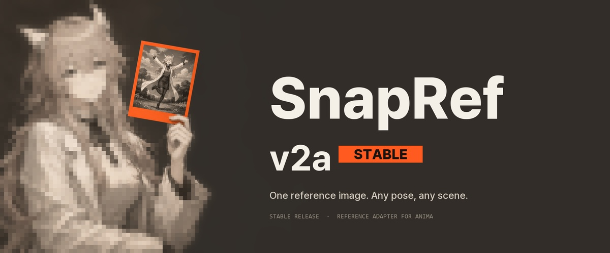
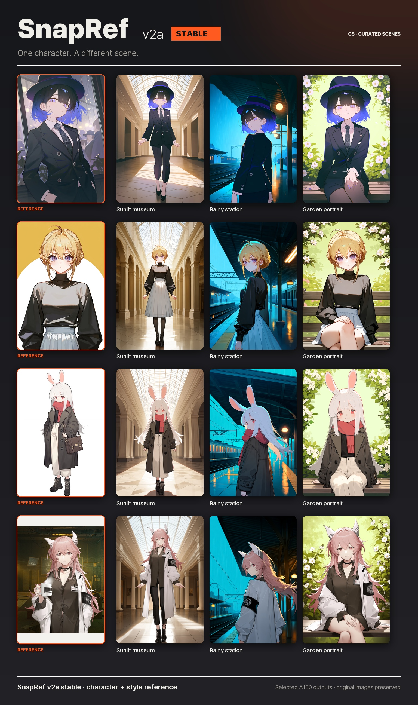
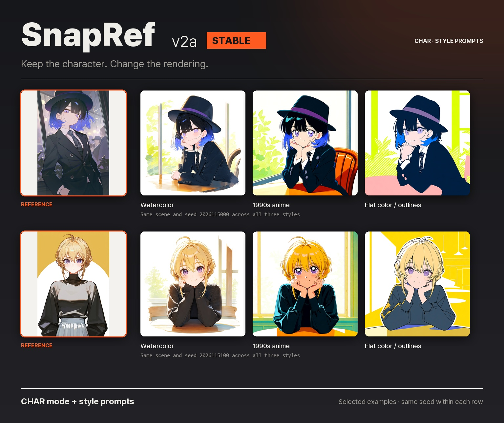
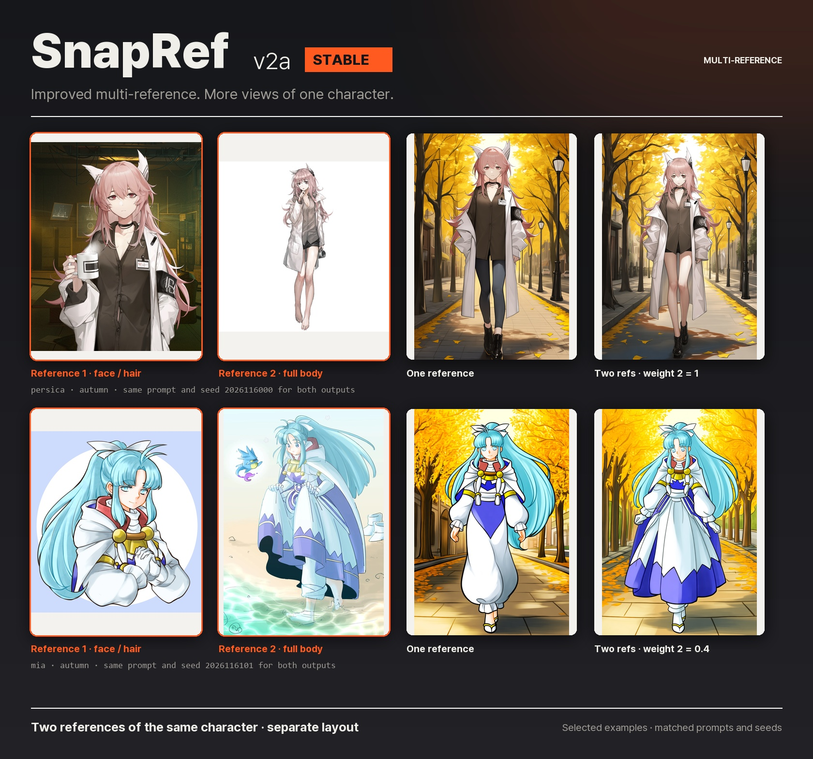
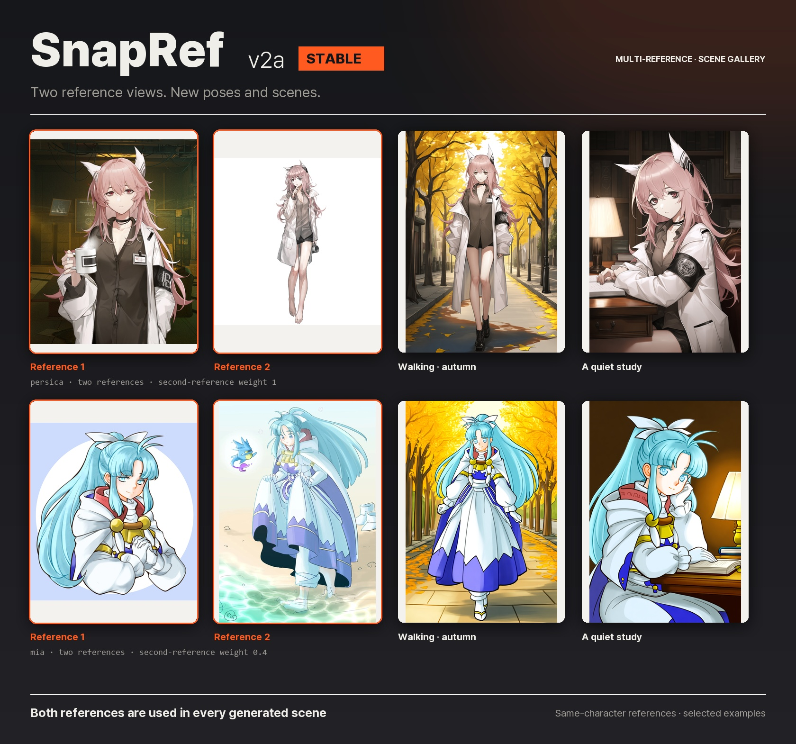
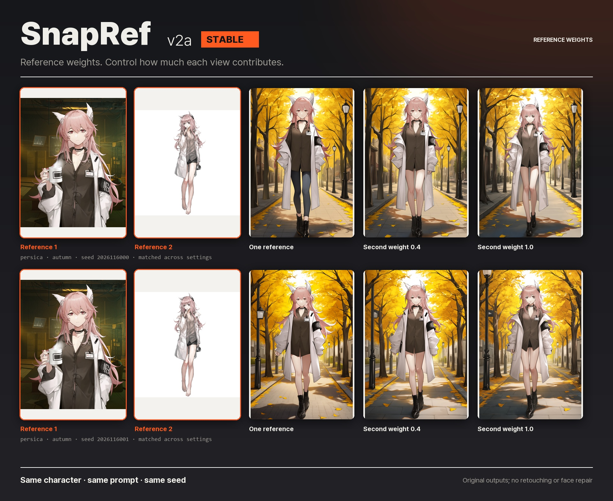
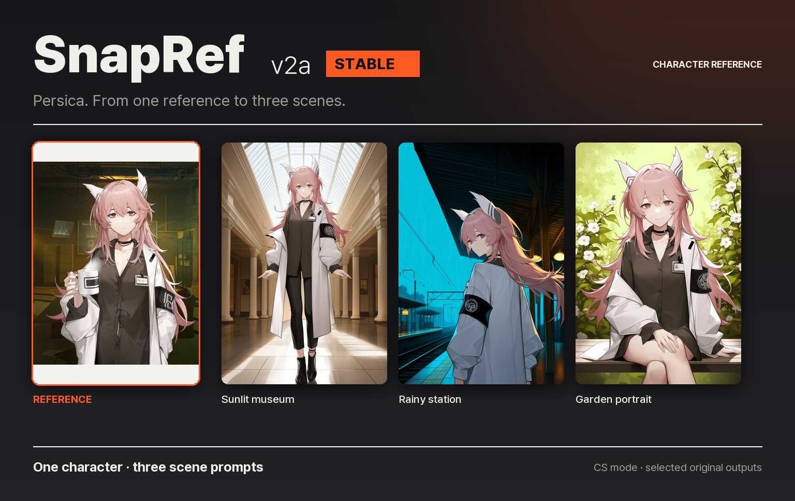
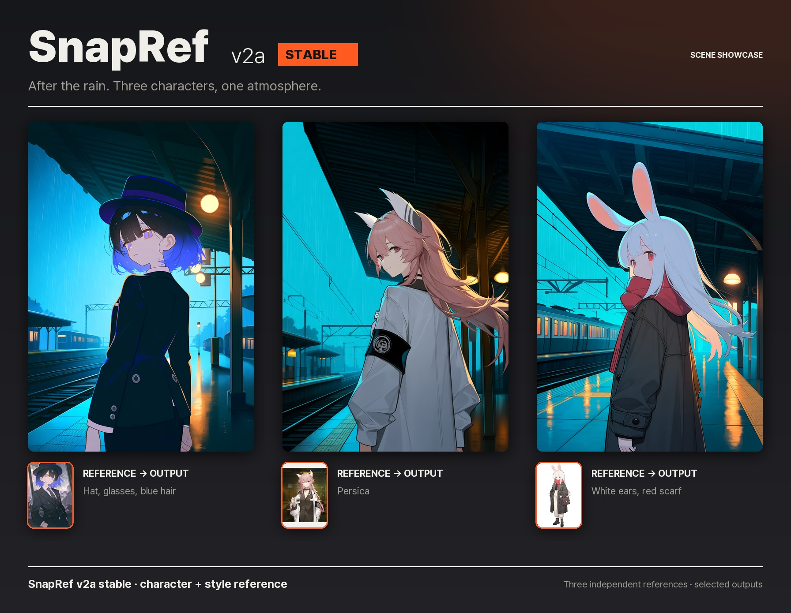
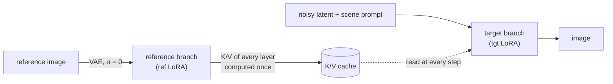

<p align="center">
  
</p>

> [!NOTE]
> **SnapRef v2a stable.** Character reference, several views of one character, and per-reference weights.
> See the [examples](#v2a-stable) and [v1a / v2a evaluation](#evaluation).

> [!IMPORTANT]
> **Please support SnapRef!** Developing these models has taken **400+ H100 GPU-hours** so far.
> If SnapRef is useful to you, a ⭐ on [GitHub](https://github.com/ArcAnima/SnapRef), sharing your results or
> reporting issues helps a lot, and GPU sponsorship is very welcome.
>
> **[Support SnapRef on Ko-fi](https://ko-fi.com/luis3207)**

<p align="center">
  <a href="https://huggingface.co/0ppxnhximxr/snapref-v2a"></a>
  <a href="https://civitai.com/models/3028191/snapref"></a>
  <a href="https://ko-fi.com/luis3207"></a>
  <a href="https://huggingface.co/circlestone-labs/Anima"></a>
  <a href="https://github.com/ArcAnima/SnapRef/tree/main/comfyui_nodes/snapref"></a>
  <a href="https://github.com/ArcAnima/SnapRef/blob/main/LICENSE"></a>
</p>

<p align="center">
  <b>Give Anima one picture of a character. Write only the scene.</b><br>
  Hair, eyes and outfit come from the reference and follow the new pose. The art style comes from the reference too,<br>
  or, with <code>mode char</code>, from the base model and your prompt.
</p>

<p align="center">
  <a href="#quick-start">Quick start</a> ·
  <a href="#v2a-stable">v2a stable</a> ·
  <a href="#evaluation">Evaluation</a> ·
  <a href="#how-it-works">How it works</a> ·
  <a href="#training-it-yourself">Training</a> ·
  <a href="#roadmap">Roadmap</a>
</p>

---

This repository contains the training, data generation and evaluation code for **SnapRef**, a reference
adapter for [Anima](https://huggingface.co/circlestone-labs/Anima) base v1.0.
**[v2a stable](https://huggingface.co/0ppxnhximxr/snapref-v2a)** is the selected stable model;
[v1a](https://huggingface.co/0ppxnhximxr/snapref-v1a),
[v1b](https://huggingface.co/0ppxnhximxr/snapref-v1b) and the earlier
[pre1](https://huggingface.co/0ppxnhximxr/snapref-v2a-pre1) /
[pre2](https://huggingface.co/0ppxnhximxr/snapref-v2a-pre2) builds remain available for comparison.
The node in `comfyui_nodes/snapref/` supports these adapter versions.

The v2a weight repository is currently private. Public downloads of v1a and the earlier releases remain available.

## Highlights

|  |  |
|---|---|
| ⚡ **Fast** | The reference is encoded once and its keys/values are cached. Generation is about 15 % slower than plain Anima, and faster than the other Anima reference adapters. |
| 🎯 **Scene-only prompts** | No character name, appearance or artist tags. The reference carries them. |
| 🔌 **Drop-in node** | One ComfyUI node patches the model. Works with the bf16 and the FP8 Anima base. |
| 🎨 **Character reference** | `mode char` takes the character and leaves the reference's art style behind (much stronger in v2a). |
| 👥 **Two characters** | Stitch two references side by side and prompt `2girls`. |
| 🧩 **Several references, one character** | `image_2`, `image_3`: e.g. an upper-body shot for the face and a full-body shot for the outfit. |
| ⚖️ **Reference weights** | `weight_1` … `weight_3`: how much each reference counts, without slowing generation down. |

## Quick start

1. Install Anima base v1.0 with its text encoder and VAE in ComfyUI.
2. Copy [`comfyui_nodes/snapref/`](comfyui_nodes/snapref) from this repository to `ComfyUI/custom_nodes/snapref/`
   (replace an older SnapRef node). This is the newest node; it works with every SnapRef version.
3. Put the weights in `ComfyUI/models/loras/`:

   | weights | |
   |---|---|
   | [`snapref_v2a.safetensors`](https://huggingface.co/0ppxnhximxr/snapref-v2a) | stable; repository currently private |
   | [`snapref_v1a.safetensors`](https://huggingface.co/0ppxnhximxr/snapref-v1a) | previous stable release; public download |
   | [`snapref_v2a_pre2.safetensors`](https://huggingface.co/0ppxnhximxr/snapref-v2a-pre2) | earlier preview |
   | [`snapref_v2a_pre1.safetensors`](https://huggingface.co/0ppxnhximxr/snapref-v2a-pre1) | earlier preview |
   | [`snapref_v1b.safetensors`](https://huggingface.co/0ppxnhximxr/snapref-v1b) | twice the LoRA rank of v1a |

   v1a, v1b and the preview builds also have FP8 variants. The v2a stable file is bf16.
4. Open an existing SnapRef workflow, select the adapter you downloaded, add your reference and queue.
   The [pre2 example workflows](https://huggingface.co/0ppxnhximxr/snapref-v2a-pre2/tree/main/workflows)
   also work with v2a stable after changing the adapter selection.

```text
masterpiece, best quality, score_7, safe, 1girl, solo, full body, sitting, crossed legs, bench, street, night
```

> [!NOTE]
> SnapRef is not a regular LoRA. Load it with a SnapRef node, not with LoraLoader.

**Two nodes.**

| node | for | inputs |
|---|---|---|
| **SnapRef** | everyone | up to eight pictures picked inside the node (click or drop), Mode (*Character & Style* / *Character*), Strength per picture, Fidelity |
| **SnapRef (Advanced)** | full control | every setting (below and in the [v1a model card](https://huggingface.co/0ppxnhximxr/snapref-v1a#settings)); saved workflows open on it unchanged |

After filling two pictures, click the square **+** button to the right of **Character** to add another
reference slot (up to eight pictures of the same character). Each picture has its own Strength; Fidelity
applies to all references. Existing one- and two-picture workflows remain compatible.

On the simple node, **Strength** is how much a picture counts (1 = as trained, 0 = off, 2 = twice) and
**Fidelity** trades detail for prompt freedom (1 = every detail of the picture; lower also lets the negative
prompt branch read the picture, so the prompt is followed more freely, about 12 % slower).

**Fidelity** is also available on the advanced node (0–1, default 1). It is ignored when
`ref_in_uncond` or `ref_guidance_on` is on. It is appended after the existing inputs to preserve saved workflows.

Inputs of SnapRef (Advanced) added for v2a:

| new node input | default | |
|---|---|---|
| `image_2`, `image_3` | | more references of the **same** character (e.g. full body when `image` is an upper-body shot) |
| `use_batch` | off | use every image of an IMAGE batch as a reference |
| `multi_layout` | `separate` | `separate`: each reference on its own. `stitch`: side by side in one reference (same speed as one image) |
| `weight_1` … `weight_3` | 1.0 | how much each reference counts (0–2, 0 = skipped); separate layout only |

The new inputs sit at the end of the node, so saved v1 workflows open unchanged.

## Anima-2.9B block routing

Both SnapRef nodes automatically recognize a 28-block adapter on Anima-2.9B's known
40-block depth expansion. Adapter hooks follow the original layers at
`0, 1, 3, 4, 6, 7, 9, 10, 12, 13, 15, 16, 18, 19, 20, 22, 23, 25, 26, 28, 29, 31, 32, 34, 35, 37, 38, 39`.
The inserted layers keep their own weights, and reference K/V caches retain all 40
actual layer positions. Native layouts keep their original routing. Other block-count
mismatches raise an error before generation rather than silently using the wrong layers.
No extra node or setting is needed.

This corrects weight routing; it does not establish reference quality on 2.9B or its
finetunes, since the adapters were trained on Anima base v1.0. CPU hook, reference-cache,
and model-reload regressions can be run with `python -m unittest discover -s tests -v`
(PyTorch and safetensors required, no ComfyUI or checkpoints).

## v2a stable

Character, style and multi-reference examples generated with the stable adapter on Anima base v1.0.



<sub>Four references, three scene prompts. Orange outlines mark the inputs. The prompts describe the scene,
pose and lighting without character names or appearance tags.</sub>

### Character styles

Keep the reference, change the style prompt. These examples use `char` mode with watercolor, 1990s anime
and flat-color treatments; the scene and seed stay the same within each row.



<sub>The reference supplies the character, while the style prompt changes the rendering. Fine details
such as eyewear and collars can still vary.</sub>

### Multi-reference

Use **two pictures of the same character**: one with a clear face and another showing the full outfit.
In `separate` layout, the references are encoded individually and used together during generation.



<sub>One reference versus two, with the same prompt and seed in each row. The second-reference weight is
**1.0 for Persica** and **0.4 for Mia**. These are selected examples, not an aggregate improvement score.</sub>

### The same pair, another scene

The same two pictures can guide a walking pose outdoors or a seated portrait in a study.
Keep `solo` in the prompt when you want one character.



<sub>Both references contribute to every output. These scenes use independently selected seeds;
the controlled one-versus-two comparison is the figure above.</sub>

### Reference weights

Start with both weights at `1.0`. If a second picture changes the look too much, try lowering its weight.
`0.4` gives it a smaller contribution; `0` skips it. Per-reference weights apply in `separate` layout.



<sub>Each row keeps the prompt and seed fixed. The first-reference weight remains 1.0.
Higher weight is not a guarantee of a better result.</sub>

### More scenes

### Persica, from a single reference

A museum atrium, a railway platform and a garden bench: different framing and lighting from one input.



### After the rain

Three independent characters under the same scene prompt. Cool platform lighting and warm reflections
give the reference designs a different atmosphere.



<sub>Selected examples generated with SnapRef v2a.
The examples are curated separately from the fixed evaluation.</sub>

## Evaluation

The fixed evaluation contains **64 cases × 2 seeds**, separate from the curated figures above.

| Metric | v1a | **v2a** |
|---|---:|---:|
| Appearance tag recall ↑ | 0.8722 | **0.8727** |
| Extra appearance tags ↓ | 0.1341 | **0.1401** |
| Head SigLIP similarity ↑ | 0.8989 | **0.8903** |
| Head DINO similarity ↑ | 0.7431 | **0.7407** |
| Head CCIP distance ↓ | 0.0684 | **0.0715** |
| Full-image CCIP distance ↓ | 0.0725 | **0.0757** |

Appearance-tag recall improves slightly, while our qualitative assessment shows substantially better
reference following than v1a. A remaining issue is that the model can struggle to reproduce facial
details when the face in the reference image is very bright.

## How it works



- **Asymmetric attention.** The target tokens attend to themselves and to the cached reference. The reference
  never attends to the target, so it can be computed once, before sampling starts.
- **Two LoRAs.** The reference branch and the target branch each have their own LoRA (v1a: rank 128 and 64).
- **Separate position.** The reference sits at its own place in the model's RoPE coordinates, so it is read for
  appearance and not copied as a layout.
- **Several references.** Each reference is encoded on its own and the cached K/V of all of them are
  concatenated; a reference weight adds `log(w)` to that reference's keys.
- **Training data.** v1a: 58,300 images generated with Anima itself (`scenes3x4`): 2,367 characters, each drawn in
  several scenes and poses in one artist style. The training prompt leaves out what the reference supplies.
  The earlier v2a-pre1 / pre2 run continued from v1a with 231,724 Danbooru illustrations as 80 % of the pairs.
  v2a stable uses a fresh adapter trained on the expanded synthetic corpus.

## Training it yourself

```bash
# 1. data: scenes x poses per character, rendered with ComfyUI (one worker per GPU)
PROJECT_ROOT=$PWD bash deploy/run_scenes3x4.sh production
# 2. text contexts + latents -> safetensors, then train, preview and compare every checkpoint
GPUS=0,1 FIRST=v1a bash deploy/train_pipeline.sh   # configs/train_asym_<name>.json
# 3. score a comparison run
python train/score_panels.py RUN_A RUN_B --label a b --out scores.json
# Historical v2a-pre1 / pre2 mixed-data training example (configs/train_v2a.json)
python train/train_asym.py --prep v2_mix_prep --config configs/train_v2a.json --init snapref_v1a.safetensors --out runs/v2a
```

| path | |
|---|---|
| `train/asym.py` | asymmetric attention, reference K/V cache, the two LoRAs |
| `train/prepare_asym.py`, `train/train_asym.py` | tensor preparation and training |
| `train/eval_asym.py`, `train/compare_refs.py`, `train/score_panels.py` | held-out loss gaps, side-by-side runs against other adapters, embedding scores |
| `train/anima_env.py`, `train/sample.py`, `train/preview.py`, `train/prepare*.py` | model plumbing on top of ComfyUI, sampling, in-training previews, shared data helpers |
| `comfyui_nodes/snapref/` | the ComfyUI nodes: SnapRef (simple, `simple.py` + `web/snapref.js`) and SnapRef (Advanced) |
| `train/detail_eval/` | detail evaluation: frozen set, renders, tag / head-crop features, paired CIs, watcher |
| `train/multiref_test.py`, `train/ccip_eval.py` | multi-reference test, CCIP identity scores |
| `datagen/select_v2_images.py`, `datagen/build_pairs_v2.py`, `train/D_build_v2_prep.py`, `train/D_merge_preps.py` | v2a-pre1 / pre2 data: Danbooru selection (tags only), training pairs, prep, merge with the generated prep |
| `datagen/clean_tags_v2.py`, `configs/datagen_scenes_v2.json` | the scenes_v2 synthetic data run (v2a-syn) |
| `train/style_research/`, `train/style_*.py` | the v2 style-transfer experiments (did not beat the baseline) |
| `datagen/` | tag catalogs, scene manifests, pose extension, ComfyUI batch workflow and GPU worker |
| `configs/` | the configs of the released runs: `datagen_scenes.json`, `train_asym.json` (v1a), `train_asym_v1b.json`, `train_v2a.json` (v2a-pre1 / pre2), `datagen_scenes_v2.json` |
| `comfyui_nodes/anima_ref_datagen_nodes/` | batched generation nodes used to render the training data |
| `deploy/` | GPU box setup, data generation launcher, training pipeline, FP8 conversion |

Data generation and training of v1a alone took about 120 H100 GPU-hours.

## Roadmap

- [x] **v1a**: asymmetric attention + K/V cache, 58k generated images. Released.
- [x] **v1b**: twice the LoRA rank. Keeps the character as well as v1a and follows the prompt slightly more closely.
  Released as [snapref-v1b](https://huggingface.co/0ppxnhximxr/snapref-v1b).
- [x] **v2a-pre1 / pre2**: continued from v1a with 80 % real Danbooru illustrations. Much stronger `mode char`;
  multi-reference and reference weights in the node. Earlier preview builds on Hugging Face.
- [x] **v2a stable**: fresh adapter on expanded synthetic data; stable weights selected and figures evaluated.
  Public weight access is not open yet. The evaluation above compares v1a and v2a.
- [ ] Multi-reference training (2–3 references → another pose), style transfer (v2.1+).

## Compatibility and troubleshooting

- **Black image with an fp16 model or `--fast`.** Fixed in the node update of 2026-10-31. Anima overflows in
  fp16. ComfyUI runs the model in fp16 when the checkpoint is stored in fp16 (many merges), with `--fp16-unet`,
  or with `--fast` / `--fast fp16_accumulation`. The old node encoded the reference in fp16 there and produced NaN.
  The new node keeps that part in fp32, as ComfyUI itself does. bf16 output is unchanged (same bits). With the
  old node, add `--bf16-unet` to the ComfyUI launch arguments, or drop `fp16_accumulation` from `--fast`.
- **Anzhc Mod Guidance:** works in either node order with the updated node. Before, applying Mod Guidance first
  dropped the reference.
- **Spectrum:** works with `ref_guidance_on` off. With it on, Spectrum-type step forecasting breaks; the node now
  logs a warning.
- **sorryhyun Mod Guidance:** with the default settings it can stop with a tensor-size error (4 vs 2). Turning on
  `ref_in_uncond` or `ref_guidance_on` avoids it.
- **SageAttention:** with `strength` or reference weights ≠ 1, the reference part uses PyTorch's fused attention,
  so a GPU where Sage is much faster can be slightly slower there.
- **Reference cache:** the reference is encoded once and kept between runs while the picture and settings stay the
  same (about 0.9 GB of VRAM for a 1 MP picture); "Free model and node cache" in ComfyUI releases it.

## Known limitations

- Very small details (earrings, fine patterns, scars) can be simplified.
- A dark-skinned reference can come out with lighter skin.
- A scene can override the reference outfit (*beach* → swimsuit). Raise `strength` or name the outfit.
- v2a does not improve every identity metric over v1a; see the fixed evaluation above.
- v2a `mode char`: a few outfit details of the reference can change (a patterned item drawn plain, a hat left out).

## License

- **Code:** Apache-2.0 ([LICENSE](LICENSE)).
- **Weights:** a derivative of the CircleStone Model, under the CircleStone Labs Non-Commercial License v1.2
  (see the model cards, e.g. [v1a](https://huggingface.co/0ppxnhximxr/snapref-v1a)). Images generated with Anima are
  subject to that license as well. Not affiliated with or endorsed by CircleStone Labs.
